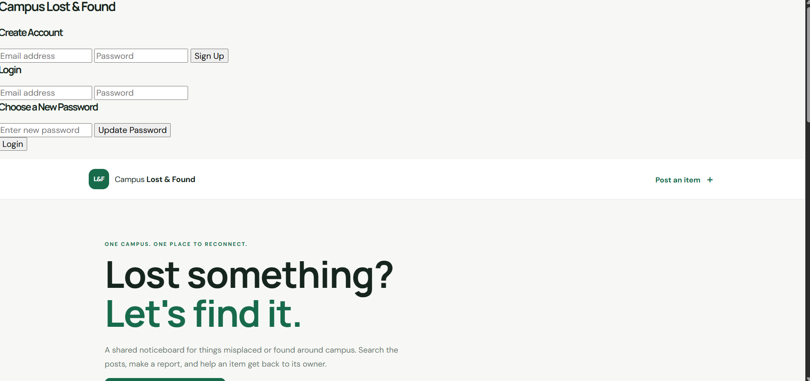
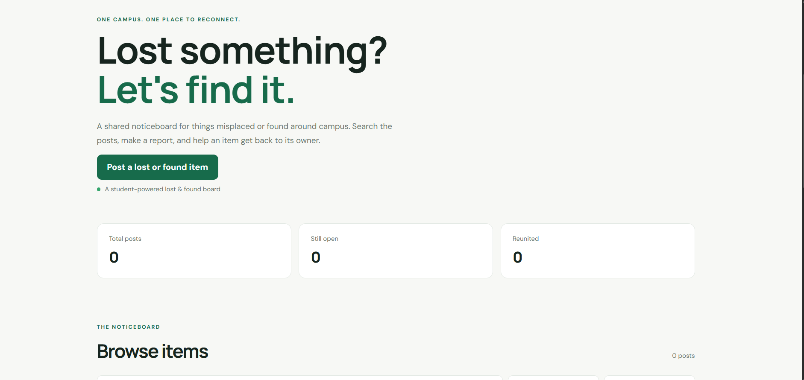
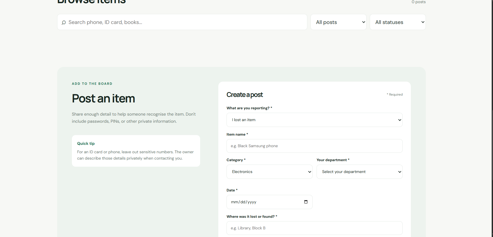
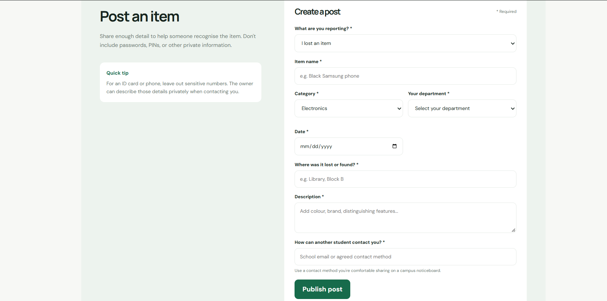

# Campus Lost & Found

## 1. Project Overview

Campus Lost & Found is a web application designed to help students report, browse, and manage lost and found items on campus. Students can publish details about missing or found belongings and search existing posts to help reconnect people with their items.

## 2. Problem Being Solved

Students sometimes lose personal belongings around campus, such as calculators, phones, books, and other school materials. Finding the owner of a lost item can be difficult because there may not be one central place to report it.

Campus Lost & Found provides a central online noticeboard where students can report lost and found items and browse available reports.

## 3. Features

The application provides the four CRUD operations:

- **Create:** Publish a new lost or found item post.
- **Read:** Browse and view existing posts.
- **Update:** Edit an existing post and change its status.
- **Delete:** Remove a post.

Other features include:

- Search for items.
- Filter posts by item type and status.
- View item descriptions, categories, dates, locations, and contact information.
- Responsive layout for different screen sizes.

**Storage limitation:** The working prototype currently uses browser `localStorage`. This means posts are stored in the browser where they were created and are not automatically shared between different devices or users.

## 4. Technology Stack

- HTML – page structure.
- CSS – styling and responsive layout.
- JavaScript – application logic and CRUD operations.
- Vite – development server and build tool.
- Git and GitHub – version control and source code hosting.
- Vercel – deployment.
- Supabase – experimental database and authentication setup; the integration is not yet complete.

## 5. Setup and Installation

### Requirements

- Node.js and npm.
- Git.
- A code editor such as Visual Studio Code.

### Steps

1. Clone the repository:

   ```bash
   git clone https://github.com/BASH-UT/lost-and-found-.git
   ```

2. Enter the project folder:

   ```bash
   cd lost-and-found-
   ```

3. Install dependencies:

   ```bash
   npm install
   ```

4. Start the development server:

   ```bash
   npm run dev
   ```

5. Open the local URL displayed in your terminal.

To create a production build:

```bash
npm run build
```

## 6. Environment Variables

The project includes an `.env.example` file showing the environment variable names used for the planned Supabase configuration.

```env
VITE_SUPABASE_URL=your_supabase_project_url
VITE_SUPABASE_ANON_KEY=your_supabase_publishable_key

## 7. Database Setup

Supabase was explored as the planned database solution.

The experimental database uses a table named `items` with the following schema:

```sql
CREATE TABLE public.items (
    id BIGINT GENERATED ALWAYS AS IDENTITY PRIMARY KEY,
    title TEXT NOT NULL,
    description TEXT,
    category TEXT NOT NULL,
    type TEXT NOT NULL CHECK (type IN ('lost', 'found')),
    department TEXT NOT NULL,
    date DATE,
    location TEXT NOT NULL,
    contact TEXT NOT NULL,
    status TEXT NOT NULL DEFAULT 'open',
    created_at TIMESTAMPTZ DEFAULT NOW(),
    user_id UUID REFERENCES auth.users(id)
);
```

To recreate this experimental database:

1. Create a Supabase project.
2. Open the SQL Editor.
3. Run the SQL schema above.
4. Configure Row Level Security (RLS) and appropriate access policies.
5. Configure authentication if testing user accounts.

**Important:** The Supabase database setup is experimental. The submitted working prototype currently uses browser `localStorage`, and the Supabase database and authentication are not fully integrated into the application.

## 8. Testing Instructions

Run the project locally using `npm run dev`, or open the deployed website.

Test the following:

1. Create a lost-item post.
2. Create a found-item post.
3. Confirm that the posts appear in the list.
4. Search for an item using its name.
5. Filter posts by type and status.
6. Edit an existing post.
7. Change an item's status.
8. Delete a post.
9. Refresh the page and check whether locally stored posts remain.
10. Test the layout on both a computer and a mobile phone.

Because the application currently uses `localStorage`, test posts are stored separately in each browser.

## 9. Live Deployment URL

[Campus Lost & Found – Live Website](https://lost-and-found-git-main-bash-ui.vercel.app/)

## 10. Screenshots

### Homepage


### Create Post


### Lost and Found Listings


### Search and Filter

